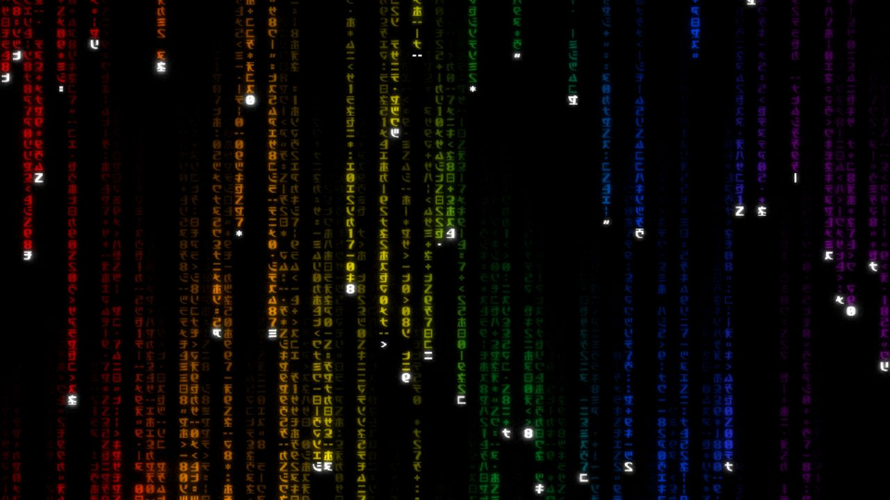

# MatrixDesktop

MatrixDesktop brings **Rezmason/matrix** digital rain, a reconstructed **UC3D**
screensaver scene, and a **ZMatrix** scene to Windows. Every scene can run as live
wallpaper behind desktop icons, in a window, fullscreen, or as a Windows screensaver.
The companion configurator provides presets, scene controls and launch arguments.

It uses **WinForms + WebView2** to load the included `web/` folder and runs fully offline.

Current source version: **1.2.0**. Tagged releases are listed on the [releases page](https://github.com/bigfnj/MatrixDesktop/releases).

### Wallpaper and ZMatrix

Choose **Wallpaper** in the configurator's window mode, or launch any scene with
`--wallpaper`. The tray menu provides pause/resume, settings, exit and explicit
per-user startup control. Wallpaper mode leaves typing and desktop icons usable;
desktop pointer effects are optional. Fullscreen applications pause it by default,
and battery pause is available separately.

```cmd
MatrixDesktop.exe --wallpaper --scene matrix
MatrixDesktop.exe --wallpaper --scene uc3d
MatrixDesktop.exe --wallpaper --scene zmatrix
```

The **ZMatrix Desktop** starter uses the original stream and font defaults.
Its controls include per-stream speed variance, a separate simulation refresh
interval, persistent dim trails, fixed and randomized cleanup, vertical phrase
streams, independent normal/phrase fonts and colors, wallpaper blending, and RGB
gain/offset. The configurator imports original ZMatrix `.cfg` files and reports
fields whose donor behavior was inactive or whose values needed conversion.

Windows supplies glyph atlases through GDI and captures wallpaper without icons
or other application windows. WebGL and WebGPU present the same persistent raster;
XOR, AND and OR use bytewise RGB operations. Browser-only previews explicitly
report font or wallpaper approximations. This is a fresh implementation of the
functional feature set, with the distributable Matrix Code Font credited separately.

The complete publish folder also contains **MatrixDesktop.scr**. The configurator's
explicit **Use for screensaver** action saves the draft and selects it for the
current user. **Restore previous screensaver** restores the prior selection.
Preview and Test Argument do not change Windows' screensaver choice.
See [ZMatrix behavior and compatibility](docs/ZMATRIX.md) for settings and limits.

### UC3D scene

Select **UC3D** in the configurator's Theme section, or use
`MatrixDesktop.exe --scene uc3d`. The new scene offers mouse and
automatic camera motion, pictures formed from code with optional 3D relief,
clock and caption overlays, a desktop snapshot, and optional sound. The
**UC3D Trilogy** starter preset uses the UC3D defaults: purple code, pink highlights,
slow falling glyphs, 3D rotation and random forward/sideways motion, matching the
owner's installed screensaver settings captured on 2026-10-23. This is a fixed
profile; later changes to the screensaver's settings are not imported automatically.

In the **UC3D** section, **Control units → Original screensaver controls** is the
default. Each slider has a synchronized numeric input:

| Original control | Argument | Range | Default |
| --- | --- | --- | --- |
| Code amount: Less / More | `uc3dAmount` | 100 to 1500 streams | 500 |
| Code size: Small / Large | `uc3dGlyphSize` | 10 to 40 | 12 |
| Fall speed: Slow / Fast | `uc3dFallSpeed` | 0 to 150 | 6 |
| Travel: Backward / Forward | `uc3dForwardSpeed` | 0 to 120 | 6 |
| Picture size: Large / Small | `uc3dPictureScale` | 100 to 300 | 100 |
| Picture delay (seconds) | `uc3dPictureDelay` | 0 to 120 | 60 |
| Clock size: Small / Large | `uc3dClockSize` | 50 to 170 | 90 |

More/Less sets stream count independently of glyph size, viewport and 2D/3D mode.
At animation speed 1, streams enter over ten seconds and grow toward lengths of
10 to 39 glyphs; visible coverage also depends on perspective, fading and camera pose. Fall speed zero
retains minimum falling motion. Travel 60 is stationary, and constant travel is
editable when 3D forward/back movement is enabled and random travel is off.
Higher picture-size values make the picture smaller.

The **Legacy MatrixDesktop controls** mode preserves the earlier columns/density/speed
mapping for customized older UC3D presets. Explicit native-unit arguments select
Original controls; without native-unit arguments, explicit generic layout/speed
arguments select Legacy controls. An explicit `uc3dControls=original|legacy`
takes priority over either set. Both sets of saved values
are retained, while generated commands emit only the active mode's units.

For example, keep the captured defaults but increase the stream count:

```cmd
MatrixDesktop.exe --windowed --no-exit-on-any-key --scene uc3d uc3dAmount=800
```

Pictures, clock, sound, mouse control, desktop capture and bloom start off.
Picture, clock and audio controls enable when the corresponding feature is selected.
The bundled font is the default; an optional local donor atlas supplies the
original character set. Random layouts and trajectories are reconstructed rather
than pixel-identical copies of the native screensaver.

Personal pictures and privately imported donor media are local inputs. The
package includes no donor binaries, pictures, music or recovered source.
See [UC3D options and local media](docs/UC3D.md) and the
[control mappings, comparison method and calibration results](docs/UC3D-CALIBRATION.md).

### Since 1.0.2

- **1.2.0** adds wallpaper hosting for every scene, ZMatrix controls and `.cfg`
  import, native font/wallpaper resources, tray playback and startup controls,
  and Windows screensaver entrypoints. Existing presets keep their saved values.
- **1.1.0** adds the optional UC3D scene in both rendering backends, local picture and
  audio inputs, an optional privately imported glyph atlas, and a starter preset.
  Original-unit sliders, native stream/movement behavior and picture formation are
  shared across WebGL and WebGPU, with a compatibility mode for older presets.
  Release assemblies retain embedded debugging symbols without shipping separate PDBs.
  Renderer teardown, boolean parsing, Looking Glass selection and WebGPU resize behavior
  are covered by regression tests. See [UC3D options and local media](docs/UC3D.md).
- **1.0.5**: the configurator's command panel was taking 42% of the window for a one-line
  command; it now takes 27% and the field list gets the space back. The window icon is read
  from the executable's own resources instead of a second embedded copy, which takes 114,688
  bytes out of the payload. The argument guide, `ArgumentCatalog` and `config.js` are now held
  to each other by tests: configurator fields need guide entries, documented flags must
  exist, and stated defaults must agree with the catalog and renderer configuration.
- **1.0.4**: `glyphIntensity` now works. It had been parsed, documented, offered in the
  configurator and set by Randomize since v1.0 while being read by no shader. It is now the
  glyph brightness multiplier alongside `cursorIntensity` and `glintIntensity`, in the palette
  and stripe effects, both renderers. `gl-matrix` swapped for upstream's minified build
  (214,503 → 52,494 bytes).
- **1.0.3**: the configurator's command panel was off the bottom of the window, taking Copy,
  Export .ps1, Randomize, Import and Test Argument with it, and the live preview was drawing
  about seven enormous columns instead of eighty. Both were one CSS property. Also reverted a
  v1.0.2 bloom change that was itself the regression, corrected two configurator colour
  defaults, and repacked `Matrix.ico` (−1.8 MB installed).

## Visual examples

These screenshots are rendered by the same bundled offline web app that MatrixDesktop hosts in WebView2.

<table>
  <tr>
    <td></td>
    <td></td>
    <td></td>
  </tr>
  <tr>
    <td><strong>Classic rain</strong><br><code>MatrixDesktop.exe --version classic</code></td>
    <td><strong>Paradise preset</strong><br><code>MatrixDesktop.exe --version paradise</code></td>
    <td><strong>Pride stripes</strong><br><code>MatrixDesktop.exe --effect pride</code></td>
  </tr>
</table>

## v1.0 highlights

- **Live preview in the configurator.** An embedded preview pane shows the rain effect
  and refreshes as you tweak fields, change presets, import, or randomize (debounced
  250ms). Toggle it from the toolbar.
- **Argument reference embedded.** `MatrixDesktop.exe --help-full` opens a scrollable
  reference dialog with the full argument guide. The configurator's `?` button shows
  the same content. No external file required.
- **Sleep/lock aware.** Locking or sleeping pauses scene playback and UC3D sound
  while the wrapper requests WebView2 suspension. Playback resumes on unlock or
  wake; WebView2 may decline suspension.
- **Crash diagnostics.** Both EXEs install an unhandled-exception handler that writes
  a `.dmp` to `%LOCALAPPDATA%\MatrixDesktop\dumps\` and surfaces the path in the error
  dialog.
- **Configurator polish.**
  - Dark/light theme toggle (persisted).
  - Out-of-range numeric inputs show a red border + allowed-range hint inline.
  - "Export .ps1" button copies the current command as a runnable PowerShell script.
- **Automated releases.** Push a version tag such as `v1.1.0` and GitHub Actions builds, zips, and
  publishes a Release with both EXEs + assets + SHA256.

## Build warning cleanup (NETSDK1137 / MSB3277)

Some Visual Studio setups (especially those configured to treat warnings as errors) will balk at:

- **NETSDK1137**: using `Microsoft.NET.Sdk.WindowsDesktop` is unnecessary for .NET 5+.
- **MSB3277**: `Microsoft.Web.WebView2` can pull in a WPF control assembly reference
  (`Microsoft.Web.WebView2.Wpf.dll`) even for WinForms-only apps, which may trigger a
  `WindowsBase` 4.0/5.0 conflict warning.

This solution addresses both:

- The project uses `<Project Sdk="Microsoft.NET.Sdk">` with `<UseWindowsForms>true</UseWindowsForms>`.
- The project removes the WebView2 WPF reference during build (WinForms-only), and also suppresses
  MSB3277 as a safety net.

## Optimization pass (what changed vs earlier drops)

The portable packaging keeps runtime assets local and omits development files.

### AppData WebView2 user data

WebView2 keeps a browser profile/cache (“user data folder”). By default, that lives under the user’s profile in `%LOCALAPPDATA%`.

This wrapper stores WebView2 user data under AppData instead of beside the EXE:

1. Primary: `%LOCALAPPDATA%\MatrixDesktop\WebView2\`
2. Fallback: `%APPDATA%\MatrixDesktop\WebView2\`
3. Last-resort fallback: `%TEMP%\MatrixDesktop\WebView2\`

This avoids WebView2 startup failures when the app is launched from read-only folders, network-style paths, or WSL-mounted locations such as `Z:\home\...`.

The bundled `web\` runtime assets are also staged into AppData before WebView2 maps them:

1. Primary: `%LOCALAPPDATA%\MatrixDesktop\Web\`
2. Fallback: `%APPDATA%\MatrixDesktop\Web\`
3. Last-resort fallback: `%TEMP%\MatrixDesktop\Web\`

This keeps WebView2 asset loading on a normal local Windows path even when the EXE itself is launched from a WSL-mounted folder.

### Smaller web payload in build/publish output

The non-runtime upstream content is **gone from the repository**, not merely excluded from
the build. Commit `bd24373` deleted `web/playdate/**`, `web/svg sources/**`,
`web/screenshot.png` (3.5 MB), `web/lib/regl.js` (unminified; the runtime loads
`regl.min.js`), and the upstream notes (`README.md`, `TODO.txt`, `glyph order.txt`,
`prettier_command.txt`, `webgpu_notes.txt`, `assets/msdf_command.txt`). See
[`VENDORING.md`](VENDORING.md).

The runtime payload comes from `MatrixDesktop/web/`: `index.html`, `js/`, `shaders/`,
`lib/`, `assets/`, and `LICENSE`, subject to the project's explicit exclusions.

The `Exclude` list on the `web\**\*` Content glob in `MatrixDesktop.csproj` still names
those deleted paths, plus `web\msdfgen\**\*` which was never vendored at all. Those clauses
match nothing on disk now and are kept only as a guard against re-import; `.gitignore`
guards the same paths on the commit side. Two clauses remain active rules:

- `web\**\*.md` and `web\**\*.txt`: these are the reason **not to add a `.md` or `.txt`
  file under `MatrixDesktop/web/`**. It would be dropped from every build and publish output,
  and `.gitignore` would refuse to track it in the first place. `web/LICENSE` survives only
  because it has no file extension.
- `web\.gitmodules`, `web\.gitignore`, `web\.gitattributes`: likewise defensive; the
  vendored copy is not a submodule.

### Invariant globalization

Publish profiles now set:

- `InvariantGlobalization=true`

Revisit this setting before adding .NET code that requires culture-aware operations.

## Runtime configuration (EXE arguments)

The upstream project is configured via **URL query parameters** (e.g., `?version=3d&effect=mirror`).

This desktop wrapper supports the same configuration by accepting command-line arguments and
appending them to the internal `index.html` URL.

## Standalone argument configurator

The solution includes `MatrixDesktopConfigurator.exe`, a companion app for building MatrixDesktop launch arguments without hand-writing the command line.

It provides grouped controls for wrapper flags and visualizer settings, color/palette/stripe editors, named presets, a live generated command, randomization controls, an `Import` button for pasted MatrixDesktop commands, and a `Test Argument` button. Test launches are kept windowed and use `--no-exit-on-any-key` by default so a generated argument can be checked without taking over the desktop.

### Configurator UI

The configurator UI (WinForms shell hosting a WebView2 page) presents all settings on a
single scrollable surface rather than tabbed pages:

- **Single-screen layout.** Groups, including the UC3D options, share a scrollable surface
  with sticky section headers. A left-hand jump list scrolls to
  a section, and a filter box narrows the visible fields by name.
- **Custom color picker.** Color, palette-stop, and stripe swatches open an in-app popover
  with a draggable saturation/value square, a hue bar, and precise hex / 0–1 RGB entry: no
  OS color dialog, and palette/stripe rows are directly editable. RGB values in generated
  commands use up to three decimal places.
- **Embedded live preview.** A preview pane renders the matrix effect (served to an iframe
  from the bundled `web/` assets) and refreshes on any change: field edits, preset
  selection, import, or randomize. Generated visual parameters also supply the preview
  settings; its viewport, random layout and camera pose can differ from a launched app.
  UC3D preview sound starts muted and has an explicit **Test sound** action.
- **UC3D controls.** The seven original-unit sliders have synchronized numeric editors.
  Controls that do not apply to the selected scene, mode or enabled feature are disabled
  with an explanation. Original and Legacy control values remain available when switching modes.
- **Range enforcement.** Out-of-range numeric inputs clamp to their allowed min/max on
  blur, and cleared fields revert to their default.

The importer accepts full `MatrixDesktop.exe ...` commands, raw argument lines, query strings, and simple `start "" /min ...` batch lines. Recognized settings populate the current draft, which can then be saved as a preset. In the Matrix scene, stripe colors are only editable and emitted when the selected effect is stripe-based: `stripes`, `customStripes`, `pride`, `trans`, or `transPride`. UC3D uses its own code-color controls.

The randomizer has three scopes: `Visual preset`, `Colors only`, and `Motion/Layout`. It keeps launch/window controls untouched, avoids camera/image/mirror/debug effects, caps generated `stripeColors` at 2–8 colors, and caps generated palettes at 3–6 stops.

On first launch, the configurator seeds `UC3D Trilogy`, `ZMatrix Desktop`, `rainbow-haze`,
`paradise`, and `stripe effects`. These are regular user presets and can be edited, renamed,
or deleted. Existing stores receive each new starter once without restoring deleted older
starters or overwriting edited presets.
Only an exact untouched older UC3D starter is migrated to Original controls; customized
older presets keep Legacy controls.

Preset storage is portable-first:

- If the publish folder is writable, presets are stored beside the configurator as `MatrixDesktopConfigurator.presets.json`.
- If the publish folder is not writable, presets are stored under `%LOCALAPPDATA%\MatrixDesktop\Configurator\`.

In framework-dependent publish output, run:

- `MatrixDesktopConfigurator.exe` to build/test/save arguments.
- `MatrixDesktop.exe` to run a generated command directly.

### Desktop wrapper defaults

By default, the WinForms wrapper launches in **borderless fullscreen across all attached monitors** and **any physical key press closes the app while MatrixDesktop is the foreground app** (software-injected key events are ignored).

Wrapper-level flags are consumed by the desktop shell itself and are **not** forwarded to the embedded web app.

### Wrapper-level flags (windowing / app behavior)

| Flag | Aliases | Summary |
| --- | --- | --- |
| `--windowed` | - | Opens in a normal resizable window instead of fullscreen. |
| `--borderless` | `--fullscreen`, `--span`, `--span-all`, `--spanall` | Borderless fullscreen across all monitors. This is the default launch mode. |
| `--single-monitor` | `--singlemonitor` | Borderless fullscreen on the primary monitor only. |
| `--monitor N` | - | Borderless fullscreen on monitor index `N` (0-based). This implies single-monitor mode. |
| `--working-area` | `--workingarea` | Uses monitor working areas so taskbars stay visible. Applies to borderless modes. |
| `--topmost` | - | Keeps the window above other windows. |
| `--no-topmost` | `--notopmost` | Turns off always-on-top behavior. |
| `--exit-on-esc` | `--esc-exit`, `--exitonesc`, `--escexit` | Enables physical ESC-to-exit (useful if any-key exit is disabled). |
| `--no-esc-exit` | `--noesc-exit`, `--no-esc` | Disables ESC-to-exit. |
| `--exit-on-any-key` | `--exit-on-anykey`, `--anykey-exit` | Closes the app on any physical key press (default). |
| `--no-exit-on-any-key` | `--no-anykey-exit` | Disables any-key exit (ESC may still exit if enabled). |
| `--foreground-key-exit` | `--require-foreground-key-exit`, `--foregroundkey-exit`, `--requireforeground-key-exit`, `--no-global-key-exit`, `--noglobal-key-exit` | Only exit on keypress when MatrixDesktop is the foreground app (default). |
| `--global-key-exit` | `--background-key-exit`, `--global-exit-on-key`, `--globalkey-exit` | Exit on keypress even when MatrixDesktop is not focused (use with caution). |
| `--hide-cursor` | `--hidecursor` | Hides the mouse cursor while the app is running. |
| `--show-cursor` | `--showcursor` | Explicitly keeps the cursor visible. |
| `--no-devtools` | `--nodevtools` | Disables WebView2 DevTools. Handy for a more locked-down distribution build. |
| `--devtools` | - | Explicitly leaves WebView2 DevTools enabled. |
| `--help` | `-h`, `/?`, `help` | Shows the built-in help dialog: a short summary of these wrapper flags. Modal. |
| `--help-full` | `--help-arguments` | Shows the whole embedded argument guide in a scrollable dialog. No sibling `.txt` needed. Checked before `--help`, so it wins if both are passed. Modal. |

Practical examples:

- Default launch (borderless across all monitors):
  - `MatrixDesktop.exe`
- Global key exit (any physical key closes even when not focused):
  - `MatrixDesktop.exe --global-key-exit`
- Windowed debug run:
  - `MatrixDesktop.exe --windowed --version 3d`
- Borderless on the primary display only:
  - `MatrixDesktop.exe --single-monitor --effect mirror`
- Borderless on monitor index 1 while keeping the taskbar visible:
  - `MatrixDesktop.exe --monitor 1 --working-area --effect mirror`
- Kiosk-style launch:
  - `MatrixDesktop.exe --borderless --topmost --hide-cursor --no-devtools`
- Disable any-key exit (ESC only):
  - `MatrixDesktop.exe --no-exit-on-any-key --version classic`
- Show the built-in help dialog:
  - `MatrixDesktop.exe --help`
- Show the full embedded argument reference:
  - `MatrixDesktop.exe --help-full`

### Example launcher script

[`RunMatrixDesktop_ARGS.bat`](RunMatrixDesktop_ARGS.bat) is a worked example of a full
argument line. Copy it into `publish\win-x64-fd\` (or an extracted release zip) beside
`MatrixDesktop.exe` and run it. Its comments cover the three ways a hand-written argument
line usually goes wrong: spaces inside comma-separated values, passing both halves of an
alias pair such as `raindropLength`/`dropLength`, and expecting `start /min` to stick when
the app un-minimises itself on startup.

For anything beyond a quick edit of that file, use `MatrixDesktopConfigurator.exe`, which
generates and validates the command for you.

Supported input forms:

- Raw query string:
  - `MatrixDesktop.exe "?version=3d&effect=mirror"`
- Key/value pairs:
  - `MatrixDesktop.exe version=3d effect=mirror camera=true`
- GNU-style flags:
  - `MatrixDesktop.exe --version=3d --effect=mirror --camera=true`
- Space-separated:
  - `MatrixDesktop.exe --version 3d --fallSpeed -0.1`

Notes:

- Values containing spaces or special shell characters should be quoted.
- Ordinary window/fullscreen key-exit uses a Windows low-level keyboard hook (WH_KEYBOARD_LL) and filters injected events (LLKHF_INJECTED / LLKHF_LOWER_IL_INJECTED). A genuine `/s` screensaver additionally exits on session input changes, including delivered software-injected keyboard or mouse input.
- NOTE: input generated via a virtual HID keyboard driver is often indistinguishable from physical hardware in user-mode; if you need to block those too, you would need device allowlisting logic.
- By default, key-exit only triggers when MatrixDesktop is the foreground app; use `--global-key-exit` to make it close on keypress even when not focused.
- If both an enable and a disable flag are supplied for the same wrapper feature, the **last one wins**.
- Boolean flags accept `true/false`, `1/0`, `y/n`, `yes/no`, and `on/off`, case-insensitively.
- Bare boolean web flags such as `--camera`, `--volumetric`, `--clickRipples`, or `--skipIntro` are treated as `true`, and so is an explicitly empty value (`--camera=`).
- Unrecognized boolean values are false; for example, `--camera maybe` and a direct
  `?camera=untrue` query do not enable the camera.
- Never put a space inside a comma-separated value unless you quote the whole value. `--stripeColors 1,0,0, 1,1,0` is split by the shell and then silently dropped as malformed; `--stripeColors 1,0,0,1,1,0` or `--stripeColors "1,0,0, 1,1,0"` both work.
- Monitor indices are 0-based and come from `Screen.AllScreens`; their order can change if displays are rearranged in Windows.
- Unknown key/value parameters pass through but are ignored by the web app. Unknown bare flags are dropped.

### Allowed arguments

The following arguments are recognized by `web/js/config.js`. UC3D-specific controls
are described in [UC3D options and local media](docs/UC3D.md) and the embedded argument guide.

#### Core selection

- `scene` (string): `matrix` (default), `uc3d` or `zmatrix`.
- `version` (string): Matrix variant preset.
  - Examples: `classic`, `3d`, `operator`, `megacity`, `nightmare`, `paradise`, `resurrections`, `trinity`, `morpheus`, `bugs`, `palimpsest`, `twilight`, `holoplay`, `neomatrixology`.
  - Aliases also exist in the codebase (e.g., `updated`, `throwback`, `1999`, `2003`, `2021`).
- `font` (string): glyph set.
  - Examples: `matrixcode`, `resurrections`, `gothic`, `coptic`, `huberfishA`, `huberfishD`, `gtarg_tenretniolleh`, `gtarg_alientext`, `neomatrixology`, `megacity`.
- `effect` (string): post-process effect.
  - Examples: `palette` (default), `plain`, `none`, `stripes`, `customStripes`, `pride`, `trans`, `transPride`, `image`, `mirror`.
- `renderer` (string): graphics backend.
  - `regl` (default WebGL) or `webgpu` (if supported on the machine).

#### Animation and layout

UC3D Original controls uses its independent sliders in place of `numColumns`,
`density`, `fallSpeed`, `forwardSpeed`, `cycleSpeed` and `raindropLength`.
Those generic controls remain available for Matrix and UC3D Legacy modes where
supported. `resolution` and `animationSpeed` remain shared; Original controls
limits animation speed to 0 to 4.

- `numColumns` (int): size of the glyph grid, clamped to 1–256.
- `width` (int): alias of `numColumns`.
- `density` (number): volumetric density multiplier, clamped to 0.01 to 8.
- `resolution` (number): render resolution scale factor, clamped to 0.05–2.
- `animationSpeed` (number): global animation multiplier.
- `forwardSpeed` (number): forward motion speed in volumetric mode.
- `cycleSpeed` (number): glyph cycling speed.
- `fallSpeed` (number): falling speed.
- `raindropLength` (number): raindrop length / spacing control.
- `dropLength` (number): alias of `raindropLength`.
- `slant` (number): slant angle in **degrees**.
- `angle` (number): alias of `slant`.

#### Quality / performance knobs

- `fps` (number): target FPS (0–60).
- `bloomSize` (number): bloom size (0–1).
- `bloomStrength` (number): bloom strength (0–1).
- `ditherMagnitude` (number): dithering amount (0–1).

#### Feature toggles and click controls

- `camera` (bool): enables webcam input (used by the mirror effect).
- `clickRipples` (bool): enables click-triggered ripples in non-mirror rain effects such as `stripes`, `palette`, or `image`.
- `clickRippleShape` (string): click ripple shape: `circle` (default), `box`, `triangle`, or `star`. Invalid values fall back to `circle`.
- `volumetric` (bool): enables volumetric/3D rendering.
- `glyphFlip` (bool): flips glyphs horizontally.
- `loops` (bool): loop mode (WIP).
- `once` (bool): render a single frame then stop.
- `skipIntro` (bool): when `false`, starts from the intro/blank-screen sequence (web default is `true`).
- `suppressWarnings` (bool): suppresses startup notices (e.g., hardware acceleration warning).
- `isometric` (bool): experimental mode toggle.

#### Glyph / color controls

- `glyphRotation` (number): rotate glyphs (degrees).
- `cursorIntensity` (number): cursor glow intensity (>= 0).
- `glyphIntensity` (number): glyph brightness multiplier (>= 0). In the Matrix scene,
  it affects the palette and stripe effects in both renderers; image and mirror effects
  have no glyph-color term. UC3D applies it directly to code bodies and picture glyphs.
  Default 1 preserves brightness; 0 removes ordinary code bodies, while cursor heads have
  their separate `cursorIntensity` control. Higher values brighten the affected glyphs.
  Inert until v1.0.4: it was parsed and documented but read by no shader.

Color values are typically provided as comma-separated triples. RGB values are usually in the 0–1 range.

- `backgroundColor` (R,G,B)
- `backgroundRGB` (R,G,B): alias of `backgroundColor`
- `backgroundHSL` (H,S,L)

- `cursorColor` (R,G,B)
- `cursorRGB` (R,G,B): alias of `cursorColor`
- `cursorHSL` (H,S,L)

- `glintColor` (R,G,B)
- `glintRGB` (R,G,B): alias of `glintColor`
- `glintHSL` (H,S,L)

Palettes and stripes are lists:

- `palette` (R,G,B,at,R,G,B,at,...): where `at` is a stop position (typically 0–1).
- `paletteRGB`: alias of `palette`
- `paletteHSL` (H,S,L,at,H,S,L,at,...)

- `stripeColors` (R,G,B,R,G,B,...): stripe color sequence.
- `stripeRGB`: alias of `stripeColors`
- `stripeHSL` (H,S,L,H,S,L,...)
- `colors`: alias of `stripeColors`

`stripeColors` is used by stripe-based effects only: `stripes`, `customStripes`, `pride`, `trans`, and `transPride`.

#### Image effect

- `url` (string): image URL to load when `effect=image`.

#### Advanced / debug

- `testFix` (string): internal compatibility/debug switch used by the upstream project.

## Build (Visual Studio)

Use **Visual Studio 2026 (18.0 or newer)** with the .NET desktop development workload.
Install the SDK selected by [global.json](global.json): currently **10.0.302**, with
newer patches in the 10.0.3xx feature band accepted. Targeting .NET 10 requires
Visual Studio 18.0 or newer; see Microsoft's
[SDK and Visual Studio support matrix](https://learn.microsoft.com/en-us/dotnet/core/porting/versioning-sdk-msbuild-vs).

1. Open `MatrixDesktopApp.sln` in Visual Studio.
2. Restore NuGet packages (Visual Studio will usually prompt you automatically).
3. Build and run:
   - **Debug**: `F5`
   - **Release**: `Build > Build Solution`

The output EXE will be in:

- `MatrixDesktop\bin\Debug\net10.0-windows\MatrixDesktop.exe`
- `MatrixDesktop\bin\Release\net10.0-windows\MatrixDesktop.exe`
- `MatrixDesktopConfigurator\bin\Debug\net10.0-windows\MatrixDesktopConfigurator.exe`
- `MatrixDesktopConfigurator\bin\Release\net10.0-windows\MatrixDesktopConfigurator.exe`

## Publish (portable, single-folder output)

The supported publish path produces a portable folder containing both executables
and their runtime assets.

### Framework-dependent portable folder (recommended)

Publish both projects together to include the renderer and configurator.

- Visual Studio publish profile: **Portable-win-x64-framework-dependent** (both projects have
  a profile with this name, and both target the same output folder on purpose)

- Or, from a terminal at the repository root:

```bat
publish-portable-win-x64-fd.cmd
```

Output: `publish\win-x64-fd\`, containing `MatrixDesktop.exe`,
`MatrixDesktopConfigurator.exe`, the `web\` and `configurator\` assets, and the WebView2
dependencies.

Requires the **.NET 10 Desktop Runtime** on the target machine. Publish both projects
together and at the same version: the script does this, and
`Portable-win-x64-framework-dependent.pubxml` explains why it matters.

### Unsupported trimming experiment

The repository retains `Portable-win-x64-trimmed-experimental` and
`publish-portable-win-x64-trimmed-experimental.cmd` as an unsupported experiment.
With the pinned .NET SDK, enabling trimming for this Windows Forms application fails
with **NETSDK1175** before publishing. Use the framework-dependent path above.

There is no single-file publish. `publish-singlefile-fd.cmd` and its `SingleFile-FD` profile
were removed after being verified non-functional: the profile used item metadata in a
property condition (MSB4190) and requested single-file compression on a framework-dependent
publish (NETSDK1176), so it never produced an executable.

## Verification gate

`tests\run-gate.ps1` is the pre-release check. CI calls its tier 1 checks once, including
the build and publish, rather than maintaining a second build sequence.

Verification needs the pinned .NET SDK, PowerShell 7, Node.js, and Python with
Playwright, Pillow and Chromium installed. PowerShell 7 is also used by a child probe
when the gate starts under Windows PowerShell 5.1. Full runtime checks additionally
use ImageMagick and an interactive Windows desktop session.

```pwsh
powershell.exe -NoProfile -File tests\run-gate.ps1 -Tier1Only
powershell.exe -NoProfile -File tests\run-gate.ps1
pwsh -NoProfile -File tests\run-gate.ps1 -Tier1Only # the CI shell
```

Tier 1 covers everything that does not need an interactive desktop session: a zero-warning
build, the native regression harness, renderer lifecycle and UC3D scenario tests,
the media importer's synthetic tests, `node --check` over every first-party web module,
every referenced shader and asset resolving, a headless DOM smoke, the embedded argument
guide, a window icon in both executables at every size the app asks for, the guide header's
version matching both csproj, embedded source-line symbols, and the publish payload.
The UC3D WebGL browser smoke checks rendered picture colors and relief as well as
animation and disposal. The original-control WebGL calibration checks slider endpoints, independent
population/size, 2D/portrait, motion and cleanup. The runtime tiers create real windows
and capture frames, so they need an attached session and cannot run on a headless runner.

One tier-1 check is about the gate itself: it asserts the publish flags it uses appear in
both of `release.yml`'s publish steps. Without that the gate measures a payload nobody ships,
which is exactly what it used to do.

The headless DOM smoke (`tests/web-smoke.py`, Playwright + Chromium) is worth calling out,
because it exists to catch the one thing the runtime tiers structurally cannot. Those tiers
photograph the real windows and measure pixel statistics, and a window whose footer has been
pushed off-screen still measures perfectly healthy: which is exactly how v1.0.2 shipped a
configurator with its whole command panel out of view. So these assertions are geometric:
bounding boxes inside the viewport, shell height equal to the viewport, the field list
actually scrolling, the command panel staying under 30% of the window, the preview pane's
aspect ratio, and WCAG contrast in both themes. It needs no GPU, no window station and no
WebView2, so it runs in CI. The additional `tests/zmatrix-configurator.py` DOM
suite covers ZMatrix editors, imports, dependencies and preview request ordering.

It also asserts that a render flag actually *changes* the render, by measuring screenshot
luminance at two values of `glyphIntensity`. That is the check whose absence let
`glyphIntensity` ship parsed, documented and inert through all of v1.0.x.

If Playwright is not installed for the interpreter it finds, the gate reports the smoke as
not verified rather than skipping it in silence. Point `MD_GATE_PYTHON` at a specific
interpreter to override the search.

Installed Edge can exercise both UC3D rendering backends with
`python tests\uc3d-browser.py --renderer both --channel msedge`. Original-control
calibration runs 22 cases on each backend:

```cmd
python tests\uc3d-calibration.py --renderer both --channel msedge
```

The [calibration record](docs/UC3D-CALIBRATION.md) describes amount/size/speed endpoints,
2D/portrait views, movement sequences, original-process comparisons and their limits.
Published-app and desktop-snapshot probes are documented in [SMOKE_TEST_PLAN.md](SMOKE_TEST_PLAN.md).
Use an interpreter with Playwright and Pillow installed. A missing WebGPU adapter reports
unverified coverage; it does not establish a WebGPU pass.

Exit codes:

| Code | Meaning |
| --- | --- |
| `0` | Pass. Every selected check ran and passed. |
| `1` | A real failure. At least one check failed and the cause is in the code or the repo. |
| `2` | Something could not be verified: a check was skipped for lack of an interactive session, missing build output, or similar. Not a pass; the skipped list is printed. |
| `3` | The gate itself broke. Treat as a harness bug, not a product failure. |

Exit 2 is worth treating as acceptable in CI while still printing the not-verified list,
which is what `ci.yml` does. Exit 1 and 3 fail the build.

## Notes / prerequisites

- This project relies on the **Microsoft Edge WebView2 Runtime** being installed.
  - On many modern Windows systems it is already present (Evergreen runtime).
  - If not installed, the app will show an error message on startup.

- Web assets:
  - The `web/` folder is copied to both **build output** and **publish output**.
  - Some upstream folders and docs are excluded from build/publish output to keep the portable folder smaller.

- WebView2 user data:
  - The wrapper stores WebView2 profile/cache data in `%LOCALAPPDATA%\MatrixDesktop\WebView2\`.
  - If LocalAppData is not writable, it falls back to `%APPDATA%\MatrixDesktop\WebView2\`, then `%TEMP%\MatrixDesktop\WebView2\`.

- WebView2 web assets:
  - The wrapper stages the bundled `web\` folder into `%LOCALAPPDATA%\MatrixDesktop\Web\`.
  - If LocalAppData is not writable, it falls back to `%APPDATA%\MatrixDesktop\Web\`, then `%TEMP%\MatrixDesktop\Web\`.

## Attribution / License

The `MatrixDesktop` wrapper code in this repository is licensed under the **MIT License**: see
[`LICENSE`](LICENSE). This covers the wrapper and new implementation source in
`MatrixDesktop/`, `MatrixDesktopConfigurator/`, `Shared/`, and `tests/`.

`MatrixDesktop/web/` is a vendored fork of **[Rezmason/matrix](https://github.com/Rezmason/matrix)**,
which is also MIT licensed, copyright (c) 2018 Rezmason. Its license text is at
`MatrixDesktop/web/LICENSE` and is reproduced at the bottom of the root `LICENSE`. Both licenses
are MIT and both copyright notices are retained. The separately bundled ZMatrix font is
freeware under its own [distribution notice](MatrixDesktop/web/assets/zmatrix/matrix-code.LICENSE).

The web tree includes local modifications and new modules. See [`VENDORING.md`](VENDORING.md)
for the change inventory, the unrecorded upstream fork point, and refresh instructions.

